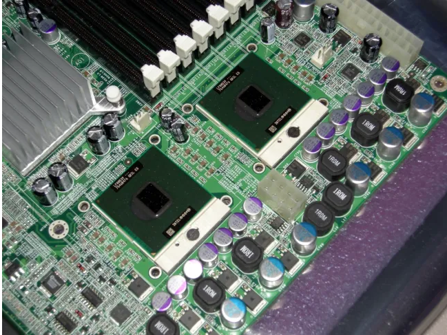
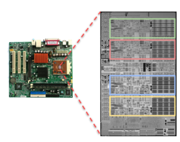
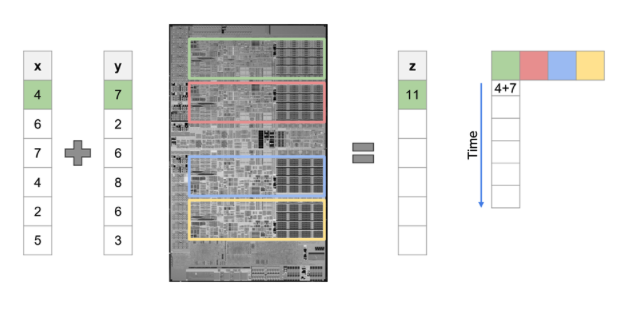
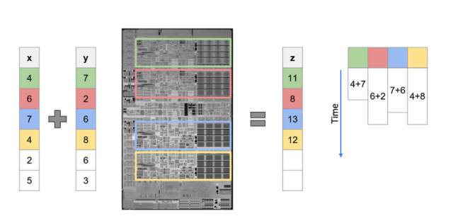
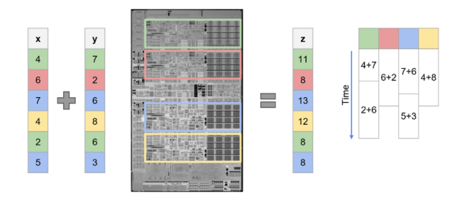
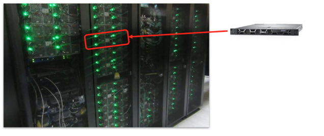
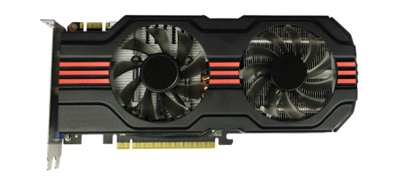
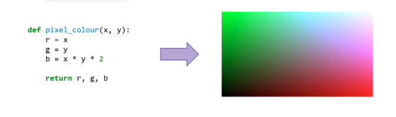

# HPC and Accelerated Compute

High-performance computing (HPC) is about using many computing resources together to solve problems that are too large, too complex, or too slow for a single normal computer. 
???+ note "Examples of HPC workloads include:"

    - Climate and weather simulations. 
    - Large‑scale molecular dynamics. 
    - Training big AI/ML models. 
    - Processing huge datasets (e.g. genomics, imaging). 

## 1. Multi-CPU and Multi-core

Initially, before multi-core systems had been invented, if you wanted more compute power, you added more CPUs. 

Here's an example of a multi-CPU motherboard: 

{ .img-left }

*Figure 1: Source: [Phoronix](https://www.phoronix.com/news/Arch-Linux-Deprecating-i686)*

CPUs communicated via a high-speed interconnect allowing for all the CPUs to share the pool of resources. This laid the foundation for development of multi-core CPUs. 

Most physical CPU chips have multiple sub-CPUs, called ‘cores’. 

This CPU has 4 cores: 

{ .img-left width="300" }

*Figure 1.1: Source:*

This means that it can do four things at once. 

If we want to add two lists of numbers together, we need a bit of the hardware to do the job. 

To add these lists together we can start by adding 4 and 7. Let’s send them to the green CPU core: 

{ .img-left width="500" }

*Figure 1.2: Source:*

Let’s send other calculations to them: 

Now the green core is busy doing the calculation, but the other three cores can be doing work at the same time. 

Let’s send other calculations to them: 

{ .img-left width="500"}

*Figure 1.3: Source:*

The four cores are all now busy doing work. 

There’s always a little bit of variation so some may finish their work earlier than others. 
As soon as one core has finished its first piece of work, we can send over the next bit: 

{ .img-left width="500"}

*Figure 1.4: Source:*

You will notice that it’s not exactly four times faster, but it is faster. 

The challenge with using multi-core programming is: 

- Designing the problem so that it can be broken down into chunks like this. 
- Avoiding one of the cores messing with data that’s being used by another core. 

## 2. Multi-node

Sometimes the problem is so big that it will either be: 

- too slow to run on one computer (even with multi-core). 
- too large to fit in the memory on one computer. 
 

This is where we scale things up to run on multiple nodes. 

There are a few ways in which a program can break up problems to distribute across multiple nodes. As an example, if you take two arrays of values a[] and b[] and want to get the results, you can distribute the problem across multiple nodes: 

Node 1: a[1] + b[1] 

Node 2: a[2] + b[2] 

Node 3: a[3] + b[3] 

Node n: a[n] + b[n] 

Each node runs its calculation and then sends the result to the control node. After each time step, each computer communicates with the other computers in the cluster to tell them what’s happening. Then they run the next calculation in the series. 

Multi-node computing is used in many different fields, for example in climate modelling and large molecular dynamics simulations. 

This is an example of a supercomputer at the University of Bristol: 

{ .img-left width="500"}

*Figure 1.5: Source:*

Inside each of those cabinets are about 40 computers on top of each other, each acting as single entity. 

The power comes from there being a lot of them connected together, but supercomputers can vary massively in size, from a cluster of Raspberry Pis with only four nodes to ARCHER2, which has 6,000 nodes, and Fugaku, which has 159,000 nodes.  

!!! question "Challenge"

    Write a short sentence that would explain what a supercomputer is to someone who doesn't know lots about computers.

    When you've written your sentence, you can take a look at ours:

    ??? success "Show our answer"

        A supercomputer is just lots of computers connected together to work on big problems.

## 3. Vector Extensions

 
Vector extensions are CPU instruction set enhancements that allow a single instruction to operate on multiple data elements simultaneously, rather than processing one value at a time. 

For example, consider the following process of adding two sets of four element arrays together; typically, each element will be added to the other during one instruction:

c[0] = a[0] + b[0] 

c[1] = a[1] + b[1]

c[2] = a[2] + b[2] 

c[3] = a[3] + b[3]

If the CPU supports the correct vector extension instruction, then this operation could be done with a single instruction: 
c[0:3] = a[0:3] + b[0:3] 

Given that a CPU typically has a fixed upper limit on the number of instructions it can execute per cycle, this is one of the many techniques CPU designers have used to improve processor performance over time, particularly for certain types of workloads. 

Over the years, several vector instruction-set extensions have been introduced, including MMX (Multi-Media Extensions), SSE (Streaming SIMD Extensions), and AVX (Advanced Vector Extensions). 

## 4. GPUs

GPUs first came to mass market in the late 1990s to make games look better. 

Over the last 25 years they have become much more powerful and flexible. 

{ .img-left width="500"}

*Figure 1.5: Source:*

GPUs (Graphics Processing Units) were originally designed to draw images on screens, especially for games. An HD screen has around 2 million pixels, and the computer needs to decide the colour of each pixel, many times per second. 

To do this efficiently: 

- The same piece of code is run for every pixel. 
- Only the input data (e.g. position, texture, lighting) changes. 

{ .img-left width="500"}

*Figure 1.6: Source:*

The image above shows how we might write a GPU program in Python. The function takes arguments about a single pixel and gives an output. The GPU will automatically run this function for every pixel at (almost) the same time. 

However, compared to most CPUs, which have between 4 and 16 cores, the latest GPUs have nearly 7,000 cores. Each core is much simpler though see,
[https://www.youtube.com/watch?v=_O9WXzE65dM&t=2s](https://www.youtube.com/watch?v=_O9WXzE65dM&t=2s).

This same idea can be transferred to outputs other than colour. The output can be any number. 

Over time, people realised this idea could be used for general‑purpose computation, not just graphics. For example, instead of computing colours, GPUs can compute: 

- Matrix multiplications for AI/ML. 
- Numerical kernels for simulations. 
- Many independent operations on large arrays. 

!!! question "Challenge"

    Write a short sentence that would explain what a GPU is used for to someone who doesn’t know much about computers. 

    ??? success "Show our answer"

        GPUs are for doing lots of the same calculation at the same time. .

!!! question "Challenge"

    Why do RIEs need to understand the difference between multi‑core, multi‑node, and GPUs?  

    ??? success "Show our answer"

        - When a job is stuck or slow, you need to know whether it’s a single‑node issue (e.g. wrong partition) or a multi‑node problem (e.g. network). 
        - When users ask for GPUs, you need to understand what GPUs are good at (many similar calculations) and when they might be overkill. 
        - When planning new hardware or advising on resource requests, you need to know the difference between CPU‑heavy and GPU‑heavy workloads. 

## 5. Exercises/Test your learning

