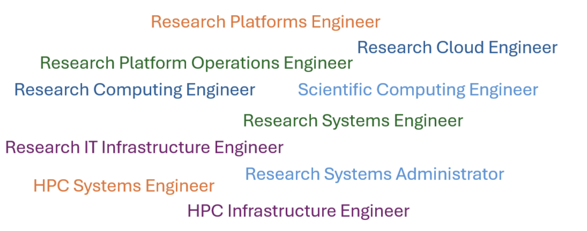

## What does a research infrastructure engineer do? 
Typical responsibilities include: 

- Designing and running research compute platforms 
    - HPC clusters, GPU/accelerated nodes, research cloud, large-scale storage. 
    - Choosing architectures, operating systems, and tooling suited to data‑ and compute-intensive research. 
- Supporting research workflows 
    - Helping researchers and Research Software Engineers (RSEs) run large jobs, pipelines and simulations. 
    - Advising on job scheduling, resource requests, containers, and performance tuning. 
- Integrating specialised tools and software 
    - Installing and maintaining compilers, libraries, domain-specific tools (e.g. for bioinformatics, climate modelling, AI). 
    - Managing environment modules, containers, and software stacks for multi-user, multi‑project environments. 
  
- Working closely with researchers and research software engineers (RSEs) 
    - Translating research requirements into infrastructure designs and co-designing solutions. 
    - Participating in grant proposals, service roadmaps, and long-term research strategies. 
- Focusing on data-intensive and compute‑intensive challenges 
    - High-throughput data ingest and storage. 
    - Long running or massively parallel jobs. 
    - Performance, scalability, and reproducibility for scientific workloads.
   
Depending on where you work and the focus of the role, RIEs may be called one of these instead: 

{ .img-center }

*Figure 1.7:*

**How does the RIE role compare to similar roles outside of research?**

As the ‘R’ in RIE stands for ‘research’ it must be key to the role! 

The mission of an RIE is to enable research, whereas in a company people in a similar role are focussed on general IT services that keep a business running. As a result, RIEs need to understand about scientific workflows, research data and how research works.  

RIEs are likely to manage HPC clusters and large storage, however a systems administrator in a company may manage more standard enterprise services. 

RIEs often work more with technical users, compared to general staff users within a company. Their users are likely to be research software engineers and researchers and so RIEs need to be able to communicate well with technical users.  

Now you have an idea about what RIEs do, continue to the next section to discover some examples of common tasks including practical exercises to try.  

