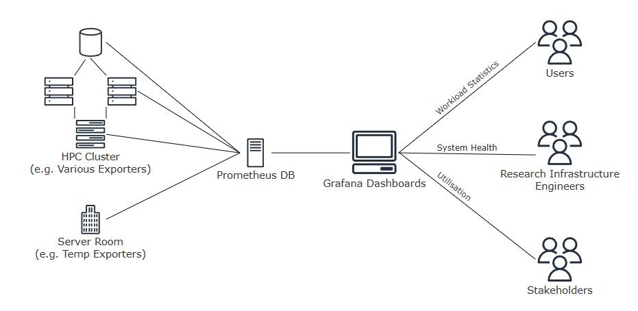

# Approaches and Tools

<!-- This whole chapter needs a review with victoria metrics in mind -->

By the end of this chapter, you will be able to:

- Explain the topology of a monitoring software stack.
- Match metrics to the hardware (and exporter) that produces them.
- Identify the parties that may be interested in collected metrics.

# How is Monitoring Performed?

Monitoring generally involves a full software stack. Multiple exporters, collect and export different metrics from a cluster, exports are gathered and collated in a monitoring database, which can then be visualised and alert conditions configured via a dashboard. 

These three components can be interchangeable, however most HPC has now standardised around a Prometheus monitoring database, with Grafana dashboards.  Prometheus has a wide range of supported exporters to cover most typical metrics and Grafana can consume data from a wide range of sources in addition to Prometheus.

???+ tip "Other Tools"

    Historically, many different tools were more commonly used for monitoring; e.g. Ganglia, Nagios/Icinga, LDMS, Zabbiex, Elastic Stack (ELK), or vendor specific tools such as HPE Performance Cluster Manager, NVIDIA DGCM. 

    <!-- @Todo: More detail, how prominent are ELK, Victoria Metrics, Cluster cockpit? -->
    
    
The combination of Prometheus and Grafana became popular in HPC due to its flexible time-series metrics and open-source codebase enabling a wide range of supported exporters and rich dashboards. Some of these other tools may still be used, possibly in combination with Prometheus and Grafana, locally at your institution. 

<!-- @Todo: Review whether this renders correctly -->

{.img-left alt="Monitoring stack topology showing exporters in an HPC cluster and server room sending data to a Prometheus database. Prometheus feeds Grafana dashboards, which are used by users, RIEs, and stakeholders."}

*Figure 1:*

## Prometheus & Exporters

Prometheus is an open-source database and related tools, specifically designed to support monitoring. It offers tools for the full-monitoring stack, including dashboards and alerts, however due to its interoperability, it is most often used for its server which acts as a central database for storing and querying monitoring timeseries. 

Prometheus operates with a pull-based scraping model, where it scrapes from attached exporters at regular intervals. It is also possible to configure for how long Prometheus will retain metrics within the database. 

There are hundreds of exporters which can be used with Prometheus, many which are irrelevant to most HPC systems. Most can be configured to select precisely which metrics to collect and potentially also the collection frequency.  

Below we introduce some of the core exporters you may come across.

### Node Exporter

As the name implies, [node exporter](https://github.com/prometheus/node_exporter) exports system metrics from HPC nodes relating to their hardware and operating systems. This can include CPU, memory, storage, networking, power and more metrics from each node within a cluster.

### SLURM Exporter

Whilst you could manually probe SLURM for scheduler metrics, [SLURM exporter](https://github.com/sckyzo/slurm_exporter) exposes all the information you might want from the scheduler to Prometheus alongside some sample Grafana dashboards. If your system instead uses Kubernetes, a SLURM exporter would be redundant.

### NVIDIA DCGM (GPU) Exporter 

If a cluster contains NVIDIA GPU’s it’s likely to use NVIDIA’s [DCGM Exporter](https://github.com/NVIDIA/dcgm-exporter) which exposes detailed metrics from NVIDIA GPUs via the Data Centre GPU Manager (DCGM) to Prometheus. This includes GPU utilization, memory usage, temperature, power draw, ECC errors, NVLink status and other hardware health and performance data from each GPU across the cluster. 

### AMD’s Service Monitor 

Likewise, if a cluster contains AMD GPUs, a [service monitor](https://instinct.docs.amd.com/projects/gpu-operator/en/latest/metrics/prometheus.html) can be created to export to Prometheus relevant AMD GPU information produced by their Device Metrics Exporter. Information includes temperature, utilisation, memory usage, power consumption, PCIe bandwidth and performance metrics. 

### Infiniband Exporter 

If a cluster for instance utilises InfiniBand for high-bandwidth communication between nodes, it would make sense to add monitoring the entire InfiniBand fabric. These metrics would include the count of occurrences for each specific errors, and potentially utilisation information such as the number of packets sent. 

### Lustre Exporter

The file systems used by a cluster, such as Lustre, will have exporters to monitor error counts and access metadata to help catch hardware failures and identify problematic jobs. 

### Bespoke Exporters

Writing a small script to export data to Prometheus may also be carried out due to it’s simplicity.  Prometheus provides a [Python package](https://github.com/prometheus/client_python), making it possible to write an exporter in less than 10 lines of code. 

This can be great if you’re using small external sensors, to monitor server room metrics such as temperature and capacity which don’t have native exporters. Some clusters will monitor the room temperature, as it may become necessary to shutdown a cluster during heat waves if the cooling is unable to cope. 

-------------

The above summary is not exhaustive, other hardware solutions will normally have exporters which can be installed to monitor them, likewise in some cases there are multiple suitable exporters. 

<!-- @Todo: Feels like we need a high-level intro to Grafana/dashboards here -->

## Keypoints

- Different accelerated compute components use different exporters to expose their metrics.
- Prometheus is a timeseries database commonly used in monitoring software stacks, which fetches and stores data produced by exporters.
- Grafana is a dashboard tool commonly used for visualising collected metrics.

<!-- @Todo: These require review/refinement, quickly drafted when porting page from word doc. -->