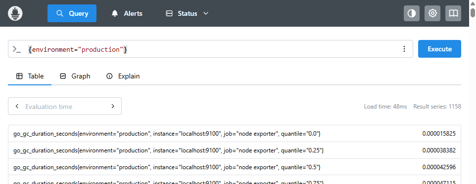
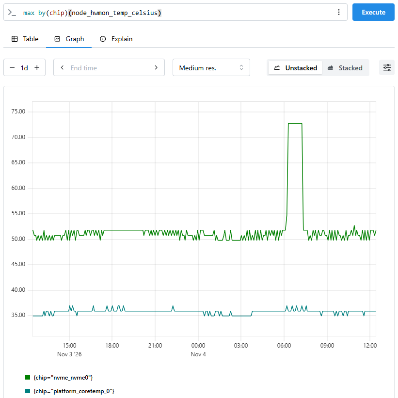

# Using Prometheus & Exporters

Prometheus and Victoria Metrics are inherently time series databases, which gather and store metrics, labelling them to help identify their source. Lets breakdown some of these new terms:

| Term        | Explanation                                                                          |
| ----------- | ------------------------------------------------------------------------------------ |
| Metric      | A named measurement, such as `node_hwmon_temp_celsius`.                              |
| Time series |	A sequence of measurements for a particular metric and unique combination of labels. |
| Label       | A key-value pair that describes a metric, such as `environment="production"`.        |

It's worth clarifying the distinction between a metric and a time series, `node_hwmon_temp_celsius` is a single metric, which can represent many different time series as a node is likely to contain many different temperature sensors and a cluster is likely to contain many nodes.

## Setting Up a New Exporters

Prometheus is provided as a stand-alone executable, which reads from a `.yml` configuration file which may refer to other `.yml` rule files. Prometheus must be restarted if these `.yml` files are changed, as only a small subset of fields (e.g. retention) are runtime reloadable. 

If running Prometheus, without any arguments it will look for the configuration `prometheus.yml` in the working directory, akin to: 

```sh 
./prometheus --config.file=prometheus.yml 
``` 

In practice, your Prometheus server will likely be configured to run as a service on a server rather than your local machine, so that it’s accessible to the whole team and automatically restarts. Check locally with your team about how to access Prometheus, and how it can be restarted when reconfiguring. For teaching purposes, here we’ll continue running it manually on the command line.

When running, by default it will serve a status page at [http://localhost:9090](http://localhost:9090), which provides querying and basic dashboard facilities for collected metrics. We’ll cover structuring Prometheus queries later in this chapter, as they can be useful when investigating spurious metrics.

Each exporter that Prometheus scrapes from, will host a small web server with a `/metrics` path. The location of each exporter must be configured within Prometheus’ configuration `.yml`.

If we download and execute [node_exporter](https://github.com/prometheus/node_exporter), which reports metrics about a local node, by default it will serve [http://localhost:9100/metrics](http://localhost:9100/metrics) (each exporter will likely have a different default port, although this will often be configurable).
 
Under the `scrape_configs` section of the Prometheus config `.yml`, we can then specify the exporter to be scraped:

```yml {title="prometheus.yml#scrape_configs"}
  # Specify a new job for our node exporter 
  - job_name: "node exporter" 
    scrape_interval: 1s # Override global scrape interval 
    static_configs: 
    - targets: # The target(s) to scrape from 
      - "localhost:9100"  
      labels: # Labels to apply to metrics from this job 
        environment: "production" 
``` 

Within this block it's possible to override the global defaults, such as `scrape_interval` for a particular job. Likewise, multiple targets can be scraped as part of the same job and labels assigned to all metrics that are scraped via the job.


???+ tip "`.yml` Mistakes"

    As the configuration is `.yml` indentation is very strict. If Prometheus is unable to read your updated configuration, an error will be produced, and it will fail to start. This error will usually specify either the affected line or section of the configuration where parsing failed. 

    For example, the below error was output when `labels` was indented by 2 additional spaces 
    
    ``` 
    time=2026-09-30T10:33:43.292+01:00 level=ERROR source=main.go:768 msg="Error loading config (--config.file=prometheus.yml)" file=/home/rob/prometheus/prometheus-3.15.0.linux-amd64/prometheus.yml err="parsing YAML file prometheus.yml: yaml: unmarshal errors:\n  line 41: cannot unmarshal !!map into string" 
    ``` 

    Likewise, it’s possible to add a spurious `-` to `labels`, leading to labelling a null target. This will build, but the label won’t be present in any scraped data. 


!!! question "Exercise 2: Adding a new scrape target to Prometheus"

    Update `prometheus/prometheus.yml` to read from node exporter which can be accessed by Prometheus at `node-exporter:9100`.

    As explained earlier, add a label `acit` to the node exporter scrape target and override it's scrape interval to be one second.

    *Once node exporter has been added as a scrape target to Prometheus, it will take time for Prometheus to gather metrics from the new source. To quickly check whether it has been configured correctly, visit http://localhost:9090/targets where it should be listed with the name you gave it.*
    
    
    ??? tip "Prometheus not running after restart?"
        When making changes to Prometheus' configuration, it's possible to introduce a syntax error which will prevent it from starting.

        If Prometheus doesn't appear to be running, try checking the output logs which might highlight a syntax error.

        ```sh
        docker compose logs prometheus
        ```
    
    ??? success "Solution"
        The below should be appended to `prometheus/prometheus.yml` (under `scrape_configs:`). `job_name` may be different however it must be remembered.

        ```yml
          - job_name: 'node_exporter'
            scrape_interval: 1s # Override global scrape interval
            static_configs:
              - targets: ['node-exporter:9100']
              labels: # Labels to apply to metrics from this job
                environment: "acit"
        ```

        Prometheus must then be restarted for the change to take effect 

        ```sh
        docker compose down
        docker compose up -d
        ```

        If working correctly, http://localhost:9090/targets should now contain a box titles "node_exporter" which will be shown as "up" in the top right corner.
        

??? note "Victoria Metrics Differences"

    Victoria Metrics can read a Prometheus scrape configuration, however it's provided at runtime differently and served on a different port.
    
    ```sh
    ./victoria-metrics-prod -selfScrapeInterval=10s -promscrape.config=prometheus.yml
    ```
    
    It will then be available at 
    
    [http://localhost:8428](http://localhost:8428)
    
    *Things will be a little bit different if the cluster version of Victoria Metrics is being used, so check with your team to understand your local configuration.*

## Querying Metrics with PromQL


<!-- https://prometheus.io/docs/prometheus/latest/querying/basics/ -->

Metrics can be queried in both Prometheus and Victoria Metrics (including via Grafana) with PromQL (Prometheus Query Language).

### Selecting Metrics


#### Select all metrics matching a label

To find all linked metrics, e.g. for production environment label before, we can use the following query:
 
```PromQL  {title="PromQL Query"}
{environment="production"} 
``` 

Within Prometheus, selecting "Query" in the navigation bar opens the query view. If the above statement is entered it should produce results similar to this: 

<div class="img-box" markdown>

The result of querying `{environment="production"}` within Prometheus, after setting up node exporter as explained earlier.
</div>
*Figure 3*

This basic query however is too broad, it returns all metrics with the production environment label which is everything output by the exporter we created.

#### Selecting a particular metric

To return all time series for a specific metric, that metric's name can be queried. For example for hardware temperatures there is the metric `node_hwmon_temp_celsius`. 

```PromQL  {title="PromQL Query"}
node_hwmon_temp_celsius
```

Returns multiple time series, each with 3 labels:

- `instance` identifies the monitored node.
- `chip` identifies a hardware monitoring chip.
- `sensor` identifies an individual temperature sensor within a `chip`.

Different hardware configurations will have different numbers of chips available per node, and in a cluster there will likely be a unique instance per node. Hence, why multiple time series with different labels are returned.

#### Filter a metric using labels

We can filter the query based on any of the labels shown within the curly brackets `{ }` of the results. For example, we can update to only query for the `platform_coretemp_0` chip's sensors 1-3.

```PromQL  {title="PromQL Query"}
node_hwmon_temp_celsius{chip="platform_coretemp_0", sensor=~"temp[1-3]"}
```

Adding `chip="platform_coretemp_0"`, filtered the query to only return metrics for that specific chip and adding `sensor=~"temp[1-3]` added a more advanced regular expression (Regex) pattern matching filter for sensors matching `temp1`, `temp2` or `temp3`.


???+ tip "Regex Notes"

    Regular Expressions are a powerful dialect for defining pattern matching criteria, used widely across all programming languages.
    
    If you're new to Regex and need to describe a pattern, you should review the [Regex reference guide](https://www.regular-expressions.info/refcharacters.html) and test your pattern works with one of many [online Regex testing tools](https://regex101.com/) which allow a Regex statement to be tested live on different test strings. These online testing tools often also provide hints to explain the rules being applied.

    PromQL RegEx statements are fully anchored (they don't permit additional leading/trailing characters), hence `temp[1-3]` is equivalent to `^temp[1-3]$` and would not match the string `"temp11"`

Four string matching operators can be used for labels:

| Operator | Meaning                | Example                       |
| -------- | ---------------------- | ----------------------------- |
| `=`      | Exact match            | `chip="platform_coretemp_0"`  |
| `!=`     | Does not exactly match | `chip!="platform_coretemp_0"` |
| `=~`     | Regex match            | `sensor=~"temp[1-3]`          |
| `!~`     | Does not match Regex   | `sensor!~"temp[1-3]`          |

Therefore, the previous sensor filter can be inverted by replacing `=~` with `!~`:

```PromQL  {title="PromQL Query"}
node_hwmon_temp_celsius{chip="platform_coretemp_0", sensor!~"temp[1-3]"}
```

It will now only show sensors with `temp4`, `temp5` and higher.

### Functions & Operators

PromQL also supports a range of functions and operators which can be used within queries to process metrics, either by performing operations across a time series or combining multiple time series.

All traditional arithmetic operations can be performed between time series (e.g. addition, through modulo [`%`] and exponent [`^`]), as can comparison operators such as equality [`==`, `!=`] and greater/less-than [`>`, `<`, `>=`, `<=`], set logic (e.g. intersection [`and`], union [`or`], compliment [`unless`]) and aggregation operations (e.g. sum, average).

It's worth reviewing the full [PromQL operators documentation](https://prometheus.io/docs/prometheus/latest/querying/operators/).

Functions are even more widespread, covering basic mathematical functions (e.g. `abs()`) and aggregations (e.g. `avg()`) through to date and histogram operations. 

It's worth reviewing the full [PromQL functions documentation](https://prometheus.io/docs/prometheus/latest/querying/functions/).

#### Aggregations

Aggregations are probably one of the most useful features of PromQL for an RIE, allowing you to answer questions about groups of time series (e.g. across multiple nodes) or reduce the resolution of a time series.

For example:

```PromQL  {title="PromQL Query"}
max(node_hwmon_temp_celsius)
```

Returns the maximum value across all time series within the `node_hwmon_temp_celsius` metric. Prometheus displays the overall maximum in the Table tab when using an instant query. In the Graph tab we can instead see how this maximum changes over time as it will be processed as a range query.

The most commonly used aggregation functions are:

- `sum(v)` for totals.
- `avg(v)` for averages.
- `min(v)` for minimum values.
- `max(v)` for maximum values.
- `topk(k, v)` largest `k` elements
- `bottomk(k, v)` smallest `k` elements
- `count(v)` the number of time series within a metric

Aggregations can be grouped according to a label with `by`, to produce multiple max, for example:

```PromQL  {title="PromQL Query"}
max by(chip) (node_hwmon_temp_celsius)
```

Displays the maximum temperature across all sensors for each chip.

<div class="img-box" markdown>

The result of a Prometheus query, grouping `node_hwmon_temp_celsius` by chip.
</div>
*Figure 4*

Alternatively, you can use `without` to remove specific labels from the output. The `without` aggregation therefore combines series that differ only by their sensor label. For example:


```PromQL {title="PromQL Query"}
max(node_hwmon_temp_celsius) without (sensor)
```

Returns a plot matching Figure 4, as `max` has been applied across all sensors of each chip, as the `chip` and `instance` labels were retained. 

In practice, you're more likely to group by the `instance` label in a cluster with multiple nodes so that nodes can be compared to expose outliers.


#### Time-based Queries

When working with time series metrics, RIEs will often want to investigate how metrics change over time.

`rate()` calculates the average per-second rate of increase of a counter over a specified time window. For example, the following query calculates the average network receive rate over the previous five minutes:

```PromQL  {title="PromQL Query"}
rate(node_network_receive_bytes_total[5m])
```

These range queries show how a value changes over time.

There are four types of metrics you might find, which each require different time-based query handling.

| Metric Type | What it measures | Typical use | Common PromQL functions |
| ----------- | ---------------- | ----------- | ------------------ |
| Counter | A value that only increases, except when reset | Network traffic, CPU time, requests | `rate()`, `increase()` |
| Gauge | A value that can increase or decrease | Temperature, memory usage, CPU utilisation | `avg_over_time()`, `max_over_time()` |
| Histogram | Observations grouped into buckets | Request durations, operation latency | `rate()`, `histogram_quantile()` |
| Summary | Statistical observations over time | Request durations and quantiles | *Usually queried directly* |

*Histograms and summaries are more advanced metric types. Their use and interpretation are beyond the scope of this introduction, but it is useful to recognise them when inspecting unfamiliar metrics.*


!!! question "Exercise 3: Using PromQL to query metrics"

    #### A) Instant Vector Query

    Enter the following query, what does this show?

    ```promql
    up
    ```

    ??? success "Solution"
        In table view, it will show a table with 2 rows, representing a metric for the two scrape jobs; `prometheus` the default exporter, and `node-exporter` that you setup during the previous exercise.

        The table shows their instant value, which are hopefully both `1` as they should be running.

    #### B) Filter Query

    Amend the previous query so that it only returns the `up` metric for your `node-exporter`.

    ??? success "Solution"
        You can filter by specifying any of the labels unique to `node-exporter` inside curly bracket, e.g.

        ```promql
        up{job="node-exporter"}
        ```

        or 

        ```promql
        up{instance="node-exporter:9100"}
        ```

    #### C) Range Vector Query

    Enter the following query, and select the "graph" tab to visualise the results.

    ```promql
    rate(prometheus_http_requests_total[5m])
    ```
    Try increasing and decreasing the time range.

    What does this show?

    ??? success "Solution"
        `prometheus_http_requests_total` is an instant vector metric, it acts as a counter of the total number of page visits labelled according to the accessed URL (`handler`) and the http response code (`code`).

        The `rate()` function calculates the rate of increase with a sliding window equal to the specified time-range. Therefore, decreasing the time-range (e.g. `[1m]`) will make the graph more spiky, as each visit will affect less sliding windows, and increasing it will have the opposite effect.

        <!-- I don't really like this, but feels like we should talk about selecting an appropriate time-range. -->
        The "best" time-range to use, would depend on the use-case and deviation, although a lower value is more representative of the truth.

    #### D) Aggregation

    Update your query, to show the combined sum of all `prometheus_http_requests_total` metrics over time, to produce a graph with a single line representing page views.

    Update this query to group requests according to `handler`, ignoring `code`, to more clearly identify the most accessed pages at any time.

    Now extend it once more, to filter so that only API calls are returned.

    ??? tip "Matching Hint"
        `.` is the Regex symbol which will match any character.
        `*` is the Regex symbol which requires the previous element of the Regex pattern to be matched 0 or more times.

        So a suitable Regex string to match only `handler` labels for API calls would be `/api/.*`.

    Which API call dominates http requests? Which is second?


    ??? success "Solution"
        To sum all `prometheus_http_requests_total` metrics, over time, wrap the earlier command with the `sum()` function.

        ```promql
        sum(rate(prometheus_http_requests_total[5m]))
        ```
        ---------

        To group them according to `handler`, instead use `sum by()`

        ```promql
        sum by (handler) (rate(prometheus_http_requests_total[5m]))
        ```

        Alternatively `sum ... without()`

        ```promql
        sum (rate(prometheus_http_requests_total[5m])) without (code)
        ```

        --------

        Filtering to only show API requires a regex match on the `handler` label, as it is not an exact match.

        The Regex string `"/api/.*"` will match any labels that begin `/api/`, this can then be added in curly brackets much the same as in exercise 2.

        ```promql
          rate(prometheus_http_requests_total{handler=~"/api/.*"}[5m])
        ```

        You should now have a graph showing a range of different activity, as using the Prometheus web interface triggers API calls in the background. 

        - `/api/v1/query_range` is probably the most frequently accessed, as completing the exercises submits calls.
        - `/api/v1/notifications/live` then has the second most calls, followed by a range of other handlers.

    <!-- Could go further and do math and comparison queries, but I don't think they add much -->


## Rules

Queries can also be used to define rules, to pre-calculate dependent metrics (recording rules), and to create alerts (alerting rules). These can be defined within separate rule `.yml` files, and will be evaluated at the frequency defined by the evaluation_interval in the main configuration file.

### Recording Rules

Recording rules, which calculate dependent metrics, can avoid the need to re-calculate expensive dependent metrics every time a dashboard is loaded.
 
The below demonstrates an example rule file which defines the record `code:prometheus_http_requests_total:sum` to sum the total number of HTTPS requests to the Prometheus server over time, for each response code.

```yml  {title="rules/http_sum.yml"}
groups:
  # Name of the group, must be unique within the rule file
- name: example
  interval: 1m # How often the rule is evaluated, overrides global.evaluation_interval
  rules:
    # Name of the record to produce  
  - record: prometheus_http_requests_total:sum_by_code  
    # PromQL expression to evaluate at each evaluation interval.
    expr: sum by (code) (prometheus_http_requests_total) 
```

If this rule file is saved as `http_sum.yml` in a `rules` subdirectory, it can be added to Prometheus’ configuration within the `rules_files` section.

```yml {title="prometheus.yml"}
rule_files: 
  - "rules/http_sum.yml" 
```

Now when Prometheus is started, a new metric with the name `prometheus_http_requests_total:sum_by_code` will be collected.

### Alerting Rules

<!-- @Todo: May want to configure alerts within Grafana -->
Alerting Rules, define conditions using Prometheus expressions which fire alerts to external services (e.g. Slack) via Prometheus’ stand-alone Alert Manager.

When configuring alerts, it’s important to follow two principles: 

Alerts should not trigger frequently; if alerts are triggering regularly, they will lead to alarm fatigue whereby RIEs become desensitised to alerts. 

Alerts must be actionable; An alert which does not lead to an imminent response, should not be an alert. Many metrics may naturally reach close to maximum during peak periods, this is not something actionable, rather it’s something that stakeholders may review in future when considering expanding the cluster. 

When defining an alert, the primary consideration is the condition that should trigger it. This typically involves setting a threshold for a specific metric, potentially requiring that threshold to be exceeded for a defined period before an alert is raised and sent to the appropriate people or channel. 

Because alert thresholds are highly dependent on local priorities and operational requirements, we recommend that they are agreed upon by the team responsible for receiving and responding to the alert. Likewise, the communication channel for alerts is likely to already be agreed at a team level, such as a Slack channel or mailing list. 
